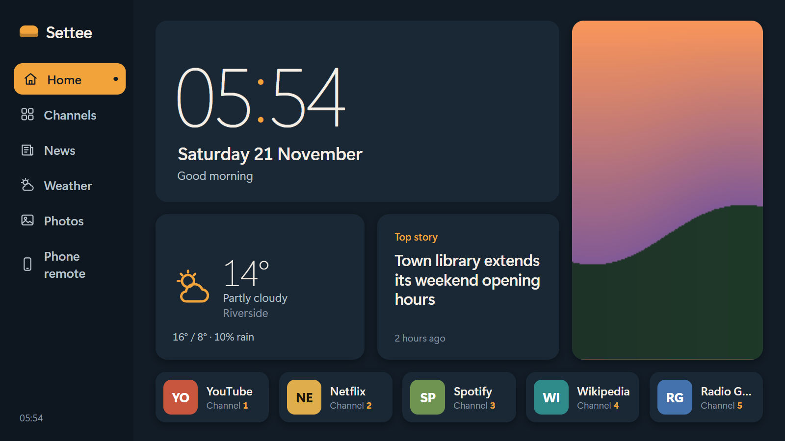
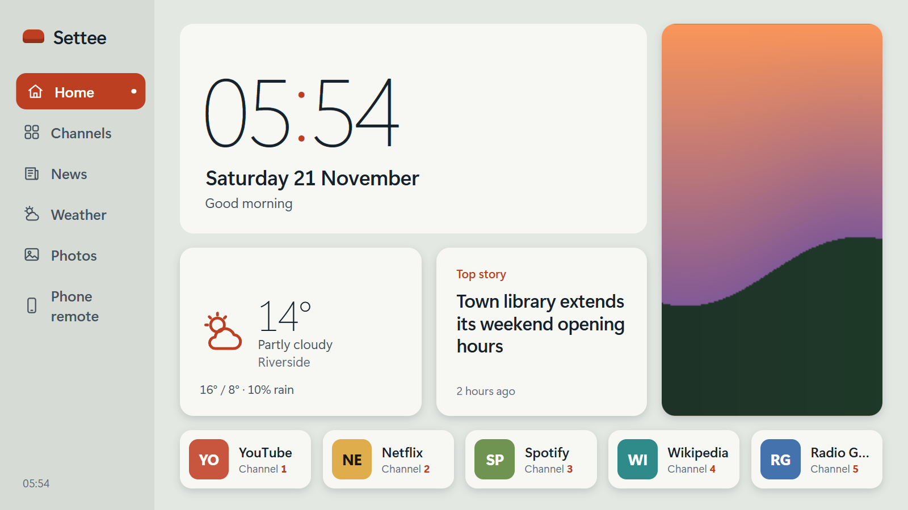
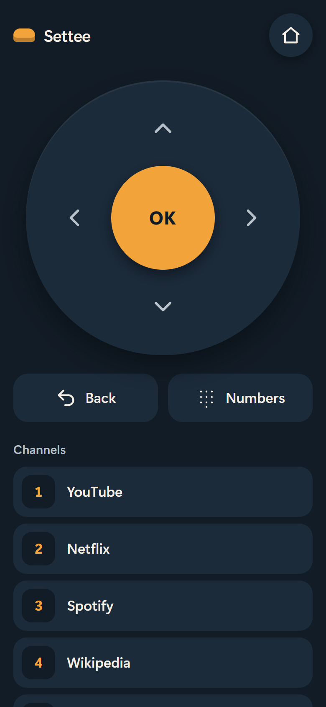

# Settee TV

Turn an old Windows PC plugged into a television into a calm TV home screen you run from the sofa, with your phone as the remote.



<p>
  
  
</p>

<sub>Screenshots use made-up news and weather.</sub>

- **A home screen of cards:** a big clock, today's weather, the top news story, a family photo and your channels.
- **Channels:** up to 30. Each one is a web site (YouTube, Netflix, a radio station…) or a program on the PC (VLC, Kodi…). Press its number on the remote to open it, and press Home to come back.
- **Phone remote:** scan a QR code on the TV and type a six-digit code. Only phones on your own Wi-Fi can reach it.
- **Weather** from Open-Meteo (no account, no key), **news** from any RSS feed, and **photos** from a folder on the PC.
- Two looks (Evening and Daylight), five accent colours, English or Swedish.
- No accounts, no ads, no tracking. Python standard library only: nothing else is installed.

Works on **Windows 7 SP1, 8.1, 10 and 11** with Chrome or Edge (the TV opens full screen in kiosk mode).

## Install

1. Download this repository (green **Code** button, then **Download ZIP**) and unzip it.
2. Double-click **`install.bat`**.
   - It uses Python 3.8 or newer if the PC already has it. If not, it downloads the official Python 3.8.10 (about 7 MB) from python.org into the Settee TV folder only. Python 3.8 is the last version that runs on Windows 7.
   - It copies the program to `%LOCALAPPDATA%\SetteeTV`, adds a **Settee TV** shortcut to the Desktop and to Startup (so the TV starts when Windows does), then starts it.
   - No admin rights are needed.
3. Windows may ask whether Python can use the network. Allow **private networks** only. That is what lets your phone reach the remote.
4. On the TV, open **Phone remote** in the menu and scan the QR code with your phone.
5. Open **http://127.0.0.1:4960/settings** on the TV's PC to choose your town, news feed, photo folder and channels.

Want to try it first? Run `start.bat --demo`. It opens in a normal window, nothing on the PC is launched, and only this PC can reach it.

Options: `install.bat -NoStartup` (no Startup shortcut), `install.bat -NoDesktop`, `install.bat -DryRun` (only print the steps). **`uninstall.bat`** removes the program, its shortcuts and its own Python. It keeps your settings in `%LOCALAPPDATA%\SetteeTV\data`.

## Ask your AI agent to set it up

Paste this into Claude Code, Codex or any coding agent running on the TV's PC:

> Set up Settee TV from https://github.com/JordanMichael58/settee-tv on this PC by following its AGENTS.md.

[AGENTS.md](AGENTS.md) tells the agent exactly what to do and what to leave to you.

## Using it

| Remote (phone) | Keyboard | What it does |
|---|---|---|
| Arrows | Arrow keys | Move around |
| OK | Enter | Open what is selected |
| Back | Esc / Backspace | Go back to the menu |
| Numbers | 0–9 | Open channel by number |
| Home (top right) | Home | Bring the TV back to the front, or open it again if it was closed |

Alt+F4 closes the TV window. The server keeps running in the background, so the phone's Home key opens the TV again.

## Running it by hand

```
python -m settee                 # server on port 4960 and the TV full screen
python -m settee --no-kiosk      # the TV in a normal window
python -m settee --port 4970 --data D:\settee-data
python -m unittest discover -s tests
```

## How it stays safe

- The TV page, the settings and the channel launcher only answer **this PC** (127.0.0.1).
- The remote page only answers addresses on your **home network**. A phone must pair with the code shown on the TV before it can press a single key. Five wrong codes lock pairing for a minute, and **Forget every phone** in the settings logs all phones out.
- The server checks the `Host` and `Origin` of every request, so a web site you visit cannot drive the TV.
- Only hashes of the phone tokens are stored.

## Credits

MIT licensed, see [LICENSE](LICENSE). The QR code is drawn by [qrcode-generator](https://github.com/kazuhikoarase/qrcode-generator) by Kazuhiko Arase (MIT). Weather data by [Open-Meteo](https://open-meteo.com/) (CC BY 4.0).
